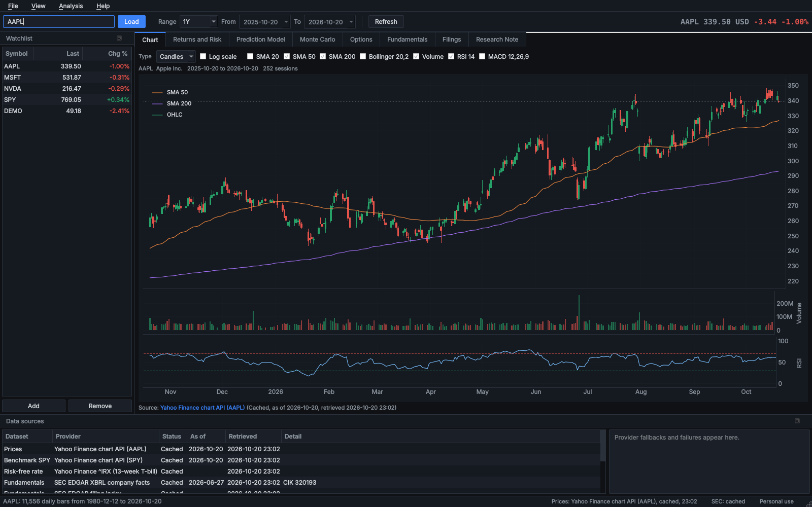
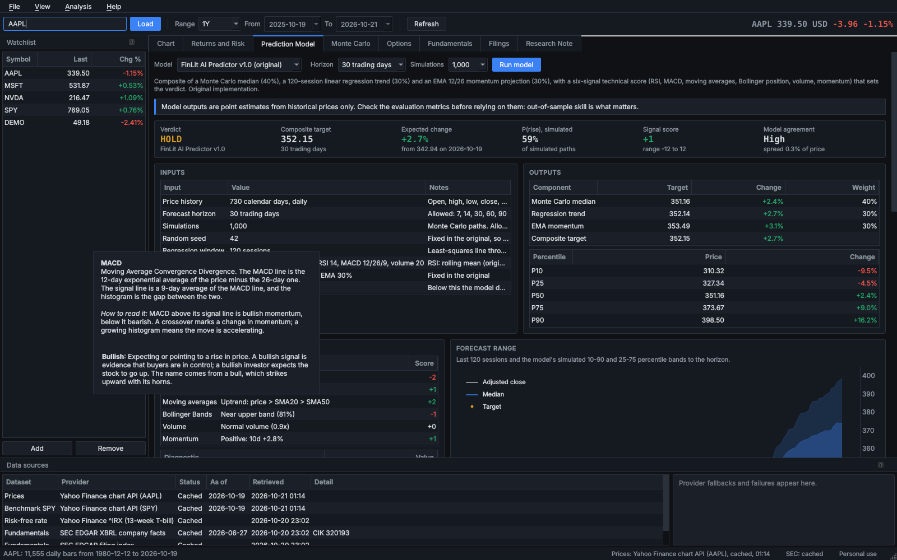
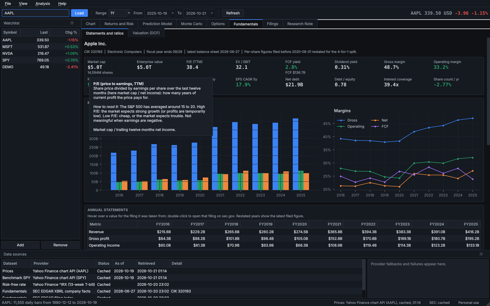
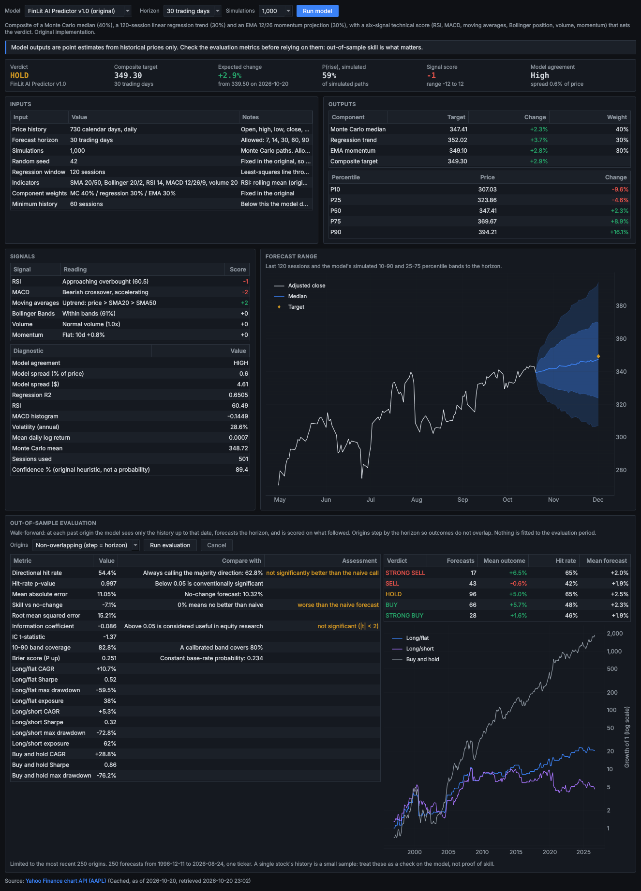
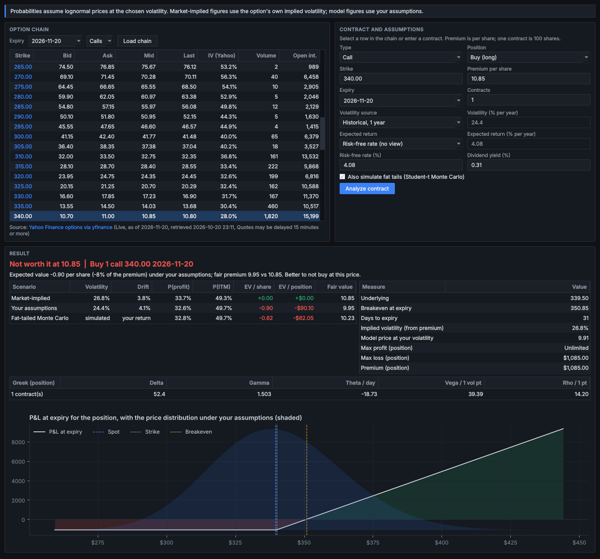
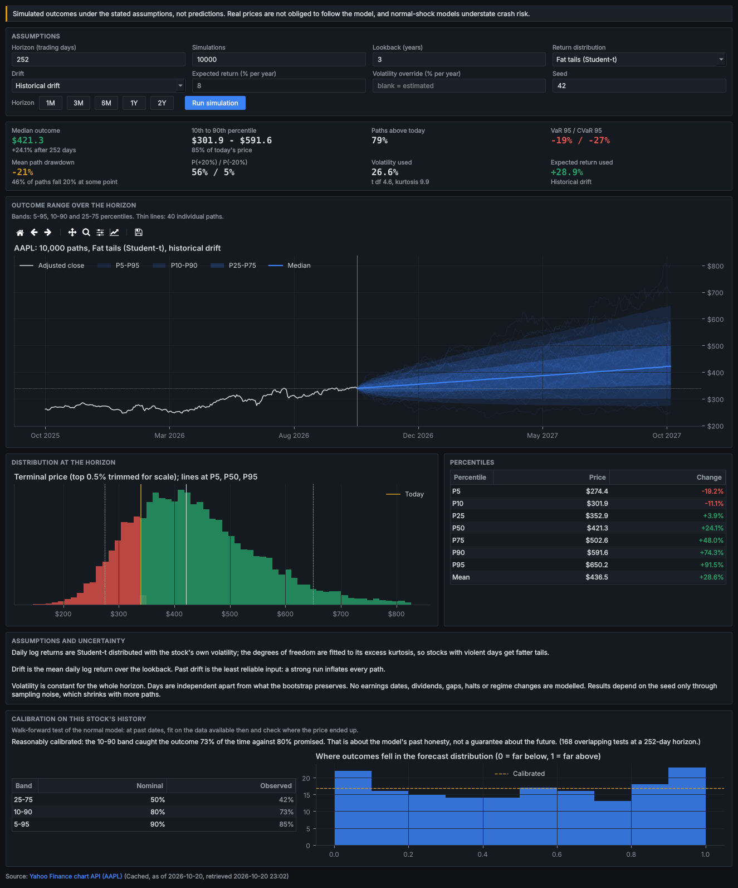
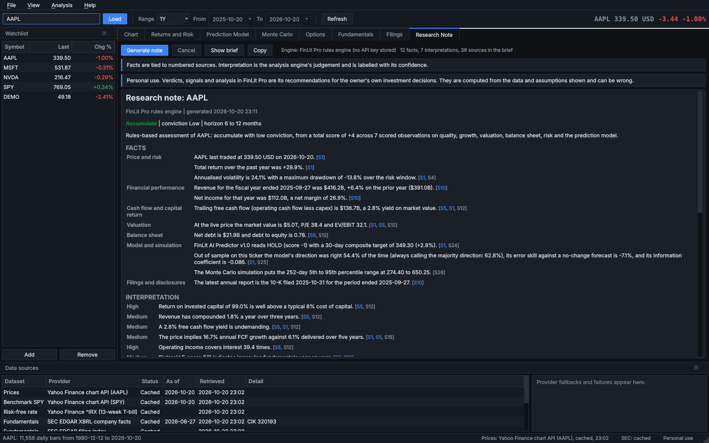
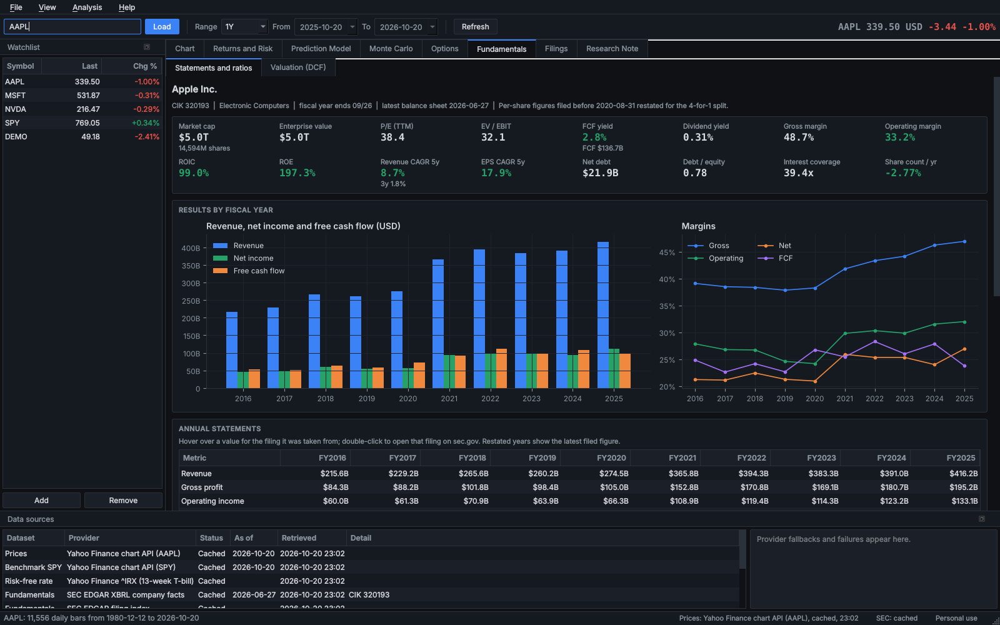
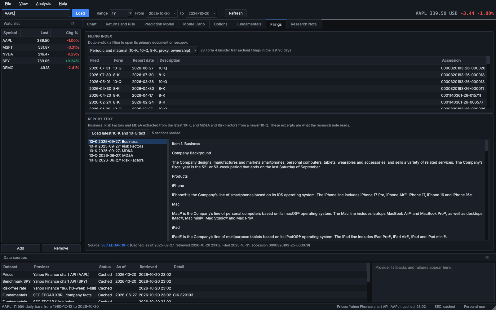

# FinLit Pro

A personal stock research workstation for Windows, built around the **FinLit AI Predictor**, the
stock-prediction model from the original FinLit Pro app.

Load a ticker and FinLit Pro pulls the price history from Yahoo Finance and the financial statements
and filings from SEC EDGAR, then runs the prediction model with an out-of-sample record of how it has
actually done on that stock, a configurable Monte Carlo simulation, an options calculator that says
whether a contract is worth its price, and a research note that cites a numbered source for every
fact. Every dataset shows where it came from, when it was retrieved and what date it describes.



> **Personal use.** FinLit Pro's verdicts, signals and research notes are recommendations for its
> owner's own investment decisions. They are computed from the data and assumptions on screen and
> can be wrong; simulations are not guarantees. See [Responsible use](docs/RESPONSIBLE_USE.md).

---

## Views

| View | What it shows |
| --- | --- |
| **Chart** | Candles or line, SMA 20/50/200, Bollinger Bands, volume, RSI and MACD on linked axes, linear or log scale, with pan, zoom and a crosshair readout of each session |
| **Returns and Risk** | Cumulative return and drawdown against a benchmark (SPY by default, any symbol), more than 20 statistics (CAGR, volatility, Sharpe, Sortino, VaR, CVaR, beta, alpha, capture ratios and more), the daily return distribution against a normal curve, rolling volatility and beta, and a monthly returns table |
| **Prediction Model** | The FinLit AI Predictor (v1.0 original or v1.1 corrected): its inputs, forecast horizon, verdict, composite target, component targets and weights, percentile range, six signals and diagnostics, a fan chart, and a **walk-forward evaluation** against naive baselines with a cost-aware strategy test |
| **Monte Carlo** | 100 to 200,000 paths over any horizon; normal, fat-tailed or bootstrapped shocks; historical, zero or your own drift; optional volatility override; fan chart, outcome distribution, percentile table, VaR and drawdowns, a plain-language list of the assumptions, and a calibration test on the stock's own history |
| **Options** | The live option chain for any expiry; for a selected or typed contract, the fair value, implied volatility, Greeks, breakeven, **probability of profit and of finishing in the money**, expected value under the market's assumptions, yours and a fat-tailed simulation, and a **Worth it / Marginal / Not worth it** verdict at the current price, with the payoff chart |
| **Fundamentals** | Ten years of statements from SEC XBRL filings with every value traceable to its filing, TTM figures, 16 ratio cards, Piotroski F-score, Altman Z-score, and a DCF with sensitivity grid, reverse DCF and Monte Carlo DCF |
| **Filings** | The company's filing index (10-K, 10-Q, 8-K, proxy, ownership; insider Form 4 count) with links, and the Business, Risk Factors and MD&A text extracted from the latest 10-K and 10-Q |
| **Research Note** | A note that separates **facts** (each citing source IDs) from **interpretation** (each with a confidence), lists risks, uncertainties and data gaps, and ends in a recommendation. Written by Claude or OpenAI with your key, or by a transparent rules engine without one |

**Hover over anything to see what it means.** Every caption, ratio, table row and value, column
heading, verdict, chart setting and choice in a list carries a plain-language definition and how to
read it: what bullish and bearish mean, what a Sharpe ratio of 0.9 says, why a P/E of 38 is high,
what delta is. **Help > Glossary** (F1) lists all 320+ terms with a search box, and the research note
shows definitions when you hover over its recommendation, conviction and confidence levels.

| Hovering a signal reading explains MACD and bullish | Hovering a ratio explains it and how to read it |
| --- | --- |
|  |  |

Around the views: ticker search by company name, a watchlist, date range presets (1M to Max) and
custom dates, a **Data sources** panel with each source's status, as-of date, retrieval time and
link, a provider log that shows every fallback, an HTML report export, CSV import and export, and a
simulated **DEMO** ticker that works with no internet.

| Prediction model and evaluation | Options: probability and worth-it verdict |
| --- | --- |
|  |  |

| Monte Carlo | Research note with citations |
| --- | --- |
|  |  |

| Fundamentals from SEC EDGAR | Filings and extracted report text |
| --- | --- |
|  |  |

## Install and run on Windows

You need **Python 3.11 or newer** (3.12 recommended) from
[python.org](https://www.python.org/downloads/windows/), installed with "Add python.exe to PATH".

1. Download or clone this repository.
2. Double-click **`setup.bat`**. It creates a private environment in `.venv` and installs everything
   (a few minutes the first time).
3. Double-click **`run.bat`** to start FinLit Pro. `run.bat MSFT` opens on a ticker.

The same steps by hand, in PowerShell:

```powershell
py -3.12 -m venv .venv
.venv\Scripts\python -m pip install -r requirements.txt
.venv\Scripts\python -m pip install --no-deps -e .
.venv\Scripts\pythonw -m finlit_pro          # or: .venv\Scripts\finlit-pro
```

To check an installation: `.venv\Scripts\python -m finlit_pro --self-test` opens the window
offscreen on DEMO and prints whether every core view loaded.

**A standalone .exe.** `build_windows.bat` builds `dist\FinLitPro\FinLitPro.exe`, which runs
without Python; copy the whole `dist\FinLitPro` folder. The **Build desktop app** GitHub workflow
builds and self-tests the same thing on a `v*` tag or on demand.

FinLit Pro also runs on macOS and Linux (`python -m finlit_pro`).

## First run

Open **File > Settings** (Ctrl+,).

* **SEC contact email** (Data tab). The SEC asks every program that reads EDGAR to identify itself
  with a contact email. It is not an account; it is sent only to sec.gov. The Fundamentals view
  asks for it the first time. Prices, the model, Monte Carlo and options work without it.
* **Analysis engine** (Analysis tab, optional). Paste an Anthropic or OpenAI key to have the
  research note written by a language model that also reads the filing text. Press **Test key** to
  check the key and the chosen model straight away (it uses the provider's free Models API, so
  nothing is billed). Keys are stored in **Windows Credential Manager**, never in a file;
  `ANTHROPIC_API_KEY` or `OPENAI_API_KEY` environment variables take precedence. Without a key the
  rules engine writes the note.

| Engine | Default model | Notes |
| --- | --- | --- |
| Claude | `claude-opus-5-5` at high effort (Sonnet 5.5 and Haiku 5.5 selectable) | Official `anthropic` SDK, streamed, structured JSON output, server-side refusal fallbacks |
| OpenAI | `gpt-5.6-luna`, falling back to `gpt-5.4-nano` | The pair the FinLit Pro website uses; strict JSON schema |
| Rules engine | none | Fixed, published thresholds; every rule is in `finlit_pro/research/rules.py` |

Type **DEMO** in the symbol box to try every view on simulated data with no network.

## Your existing model, and how it is integrated

The model was found in `KrishModi6/finlit-pro-legacy`, `app.py`, the Streamlit "AI Predictor" page:
a Monte Carlo median (40%), a 120-session regression trend (30%) and an EMA momentum target (30%),
with a six-signal technical score that sets a STRONG BUY to STRONG SELL verdict.

* **v1.0 is the original, unchanged**, and is the default. A test runs an independent
  transcription of the original code (loops and global random generator included) and checks the
  port matches it to 1e-9.
* **v1.1 fixes four documented defects** (RSI formula, an off-by-one in momentum, linear
  extrapolation of the EMA gap, and a "confidence %" that was not a probability) and changes
  nothing else.
* **Hedge-fund-style review, not new capabilities.** The model's inputs, outputs and parameters are
  its own. What is added around it is how a fund would vet a signal before trusting it: a versioned
  interface with an explicit input specification, reproducible seeded runs, and a point-in-time
  walk-forward evaluation against naive baselines with significance tests, band calibration, a Brier
  score, results by verdict, and a long/flat and long/short test after transaction costs against
  buy-and-hold. No performance figures are claimed anywhere: they are computed for the ticker on
  screen.
* **Integration point.** Any model that implements `PredictionModel`
  (`finlit_pro/model/interface.py`) and is registered in `finlit_pro/model/registry.py` appears in
  the Prediction view, is evaluated the same way and is cited in the research note.

Details: [Model card](docs/MODEL.md).

## Architecture

Python 3.11+, PySide6 (Qt) for the desktop interface, pyqtgraph for interactive time series,
matplotlib for distributions, numpy and pandas for the computation. Layers: `data/` (network,
caching, provenance), `model/` (the prediction model, its interface and evaluation), `analytics/`
(indicators, Monte Carlo, risk, valuation, options), `research/` (sources, brief, engines, note) and
`ui/`. Only `ui/` imports Qt, so everything else runs in a script:

```python
from finlit_pro import pipeline
ws = pipeline.load("MSFT", email="you@example.com")
ws.forecast.verdict, ws.evaluation.metric("Information coefficient").display, ws.ratios["pe"]
```

Network work and long computations run in background threads, and results that arrive after the
ticker has changed are discarded. Details: [Architecture](docs/ARCHITECTURE.md).

## Data sources

| Source | Used for |
| --- | --- |
| Yahoo Finance chart and search endpoints (unofficial) | Daily prices, dividends, splits, quotes, ticker search, headlines, the 13-week T-bill rate |
| Yahoo Finance options, through `yfinance` (unofficial) | Option chains |
| SEC EDGAR (official) | Ticker to CIK, XBRL financial statements, filing index, filing documents |

Yahoo's endpoints are undocumented and intended for personal use, so FinLit Pro does not assume they
are available or unrestricted: it throttles to 2 requests per second, caches everything, falls back
from the chart API to yfinance, then to the last saved copy, then to a CSV you import, and labels
every fallback. SEC requests stay at 5 per second, under the SEC's limit of 10, with the required
contact email. Details, terms and timestamps: [Data sources](docs/DATA_SOURCES.md).

## Every input is validated

Each field rejects blanks, letters, decimals where a whole number is needed, zero, negatives and
out-of-range values, and says what to type instead:

* Simulations `abc`: *Simulations must be a number, but "abc" contains letters or symbols. Enter digits only, like 100.*
* Simulations `0`: *Simulations must be greater than zero. Enter a positive whole number like 100.*
* Contracts `2.5`: *Contracts must be a whole number. Try 2 instead of 2.5.*
* Ticker `AA PL`: *"AA PL" has a space in it. Enter one ticker at a time, like AAPL.*
* Premium left blank: *Premium is empty. Enter a number.*
* Discount rate 2% with terminal growth 3%: *The discount rate (2.0%) must be higher than terminal
  growth (3.0%), or the terminal value is infinite. Raise the discount rate or lower terminal growth.*

## Choices made

Where the request left details open, these are the choices, and where to change them:

| Choice | Why |
| --- | --- |
| Recommendations are stated as recommendations for the owner, once, plainly (`framing.py`) | You asked for analysis that is investment advice for you, not a tool that hedges every screen; uncertainty is still shown where it applies |
| v1.0 of the model is the default; v1.1 sits beside it | The request was to integrate your model, not replace it |
| PySide6 + pyqtgraph | Native Windows look, fast interactive charts on 40 years of daily bars, mature packaging |
| Yahoo through a provider chain, SEC direct | Yahoo has no official API, so no single route is trusted; EDGAR is official and free |
| Keys in Windows Credential Manager only | No plain-text secrets on disk; the app refuses to save a key if no secure store exists |
| Option verdict at a 5% edge | Below 5% of the premium, the difference is within the noise of the volatility estimate, so it reads "Marginal" |
| Option chain opens about 30 days out | Weekly contracts expiring tomorrow make every probability collapse to the strike |
| Evaluation uses non-overlapping origins and 500 simulations per forecast | Independent outcomes keep the significance tests honest; 500 paths keep a 250-forecast evaluation to seconds |
| A rules engine when no API key is stored | The research note works offline, and every rule it applies is readable |

## Tests

```powershell
.venv\Scripts\python -m pip install -r requirements-dev.txt
$env:QT_QPA_PLATFORM = "offscreen"; .venv\Scripts\python -m pytest -q
.venv\Scripts\ruff check .
```

469 tests, about two and a half minutes, no network and no API keys needed (providers are replaced by fakes).
They cover: input validation; indicators; the model (v1.0 against a transcription of the original,
v1.1 differences, the integration point); the walk-forward evaluation (point in time, metrics by
hand); Monte Carlo (including a regression test for the double Ito correction) and calibration;
options (textbook prices, put-call parity, Greeks against finite differences, implied volatility,
probabilities against simulation, verdicts); risk and valuation; the HTTP layer (cache, stale
fallback, rate limiting, error messages); the price provider chain and CSV import; SEC extraction
on hand-built filings (tag changes, restatements, TTM, debt, share classes, splits, provenance);
filing text extraction; the research brief, citation checks, rules engine, and the Claude and
OpenAI engines against fake clients; credential storage and the key test; the glossary (every
term defined, labels resolving to the right term, and every row name in every table carrying its
definition in the real window); and the real window driven offscreen on DEMO. CI runs them on
Windows and Linux.

## Project structure

```
finlit_pro/
  config.py, credentials.py   Settings (no secrets) and keys in the OS credential store
  validation.py               Every input check, with the messages shown
  framing.py, fmt.py          How outputs are described; number formatting
  glossary.py                 Every term's definition and how to read it (the hover text)
  workspace.py, pipeline.py   Everything for one ticker; loading it without a window
  data/                       http, prices (provider chain), yahoo, yf_provider, sec, filings, demo, models
  model/                      interface (integration point), finlit_predictor, registry, evaluation
  analytics/                  indicators, montecarlo, risk, valuation, options
  research/                   sources, brief, prompt, note, claude, openai_provider, rules, render
  ui/                         app, main_window, settings_dialog, glossary_dialog, report, theme, widgets, workers, views/
  selftest.py                 --self-test
tests/                        pytest suite
packaging/                    PyInstaller spec and launcher
docs/                         ARCHITECTURE, MODEL, DATA_SOURCES, RESPONSIBLE_USE, ALGORITHMS, FIXLOG, screenshots
setup.bat, run.bat, build_windows.bat
```

## Documentation

* [Model card](docs/MODEL.md): the model, its versions, its evaluation and the integration point
* [Architecture](docs/ARCHITECTURE.md): layers, threading, errors, settings and credentials
* [Data sources](docs/DATA_SOURCES.md): every provider, its terms, caching, fallbacks and timestamps
* [Responsible use](docs/RESPONSIBLE_USE.md): what the recommendations rest on and where they stop
* [Algorithms](docs/ALGORITHMS.md): pseudocode for every calculation
* [Fix log](docs/FIXLOG.md): every defect found, as First Version / Current Version / Why

## Moving it to its own repository

This folder is self-contained. To give it its own repository with its history:

```bash
# from the FinLit-Pro repository root
git subtree split --prefix finlit-pro-desktop -b finlit-pro-desktop-only
# create an empty repository named finlit-pro-desktop on GitHub, then:
git push https://github.com/KrishModi6/finlit-pro-desktop.git finlit-pro-desktop-only:main
```

The GitHub Actions workflows in `.github/` start running once it is the repository root.
