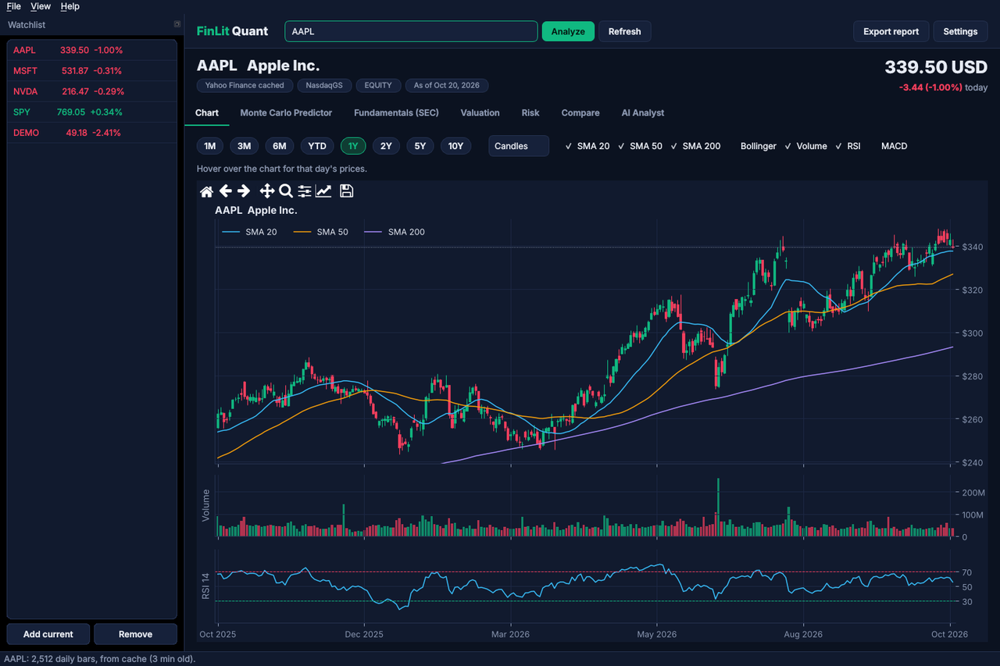
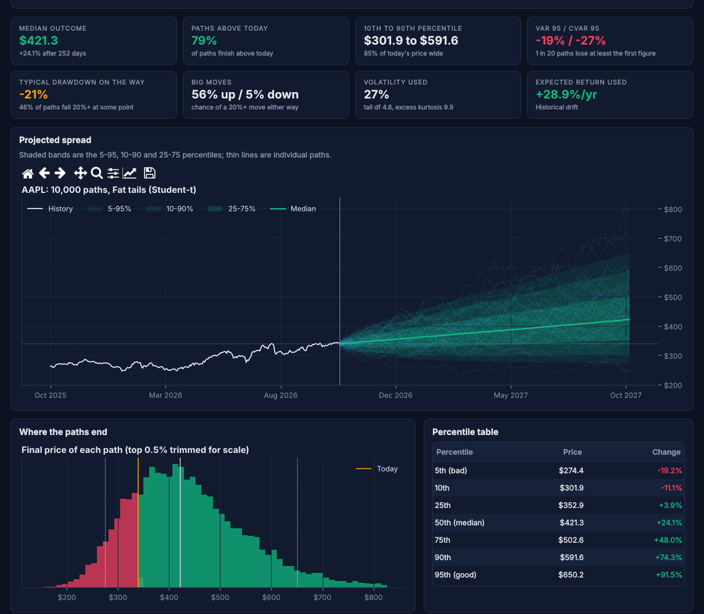
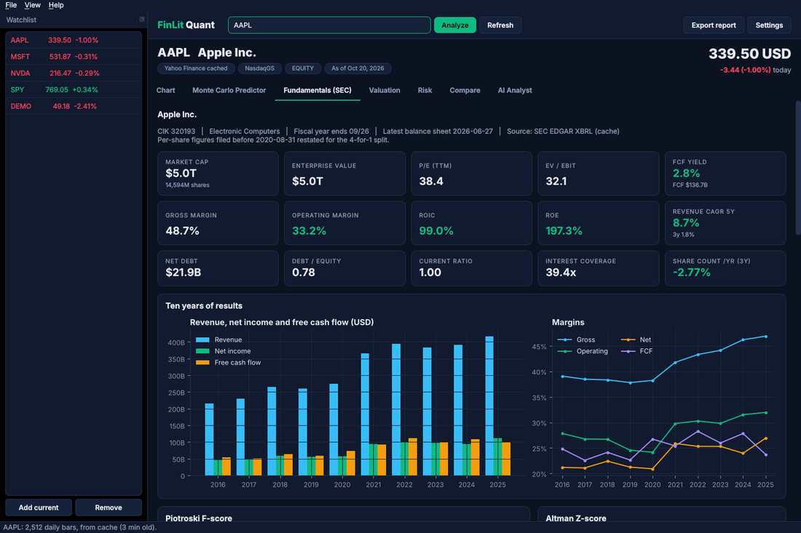
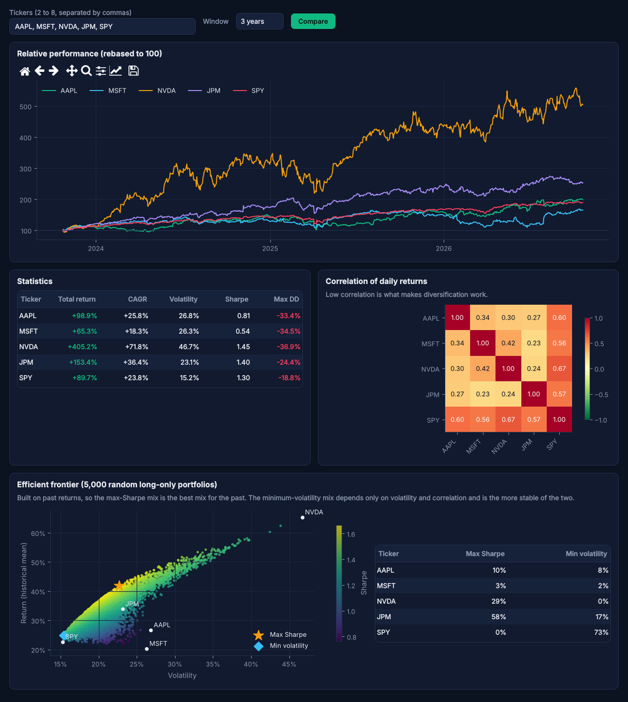
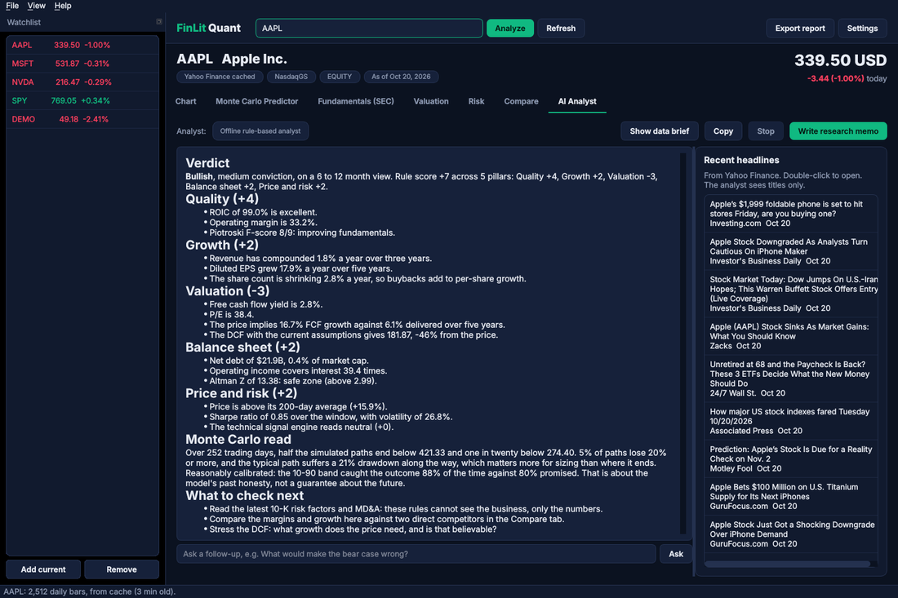

# FinLit Quant

A standalone desktop stock research workstation, built around the **FinLit Pro AI Predictor**.

Type a ticker and you get what a hedge fund analyst pulls up first: an interactive price chart with
technicals, a Monte Carlo predictor that also tests how honest its own forecasts have been,
ten years of fundamentals straight from SEC filings, a DCF with a reverse DCF and sensitivity grid,
risk statistics against a benchmark, multi-stock comparison with an efficient frontier, and an AI
analyst that writes a research memo from all of it.




---

## What is in it

| Tab | What it does |
| --- | --- |
| **Chart** | Candles or line, SMA 20/50/200, Bollinger Bands, volume, RSI and MACD panels, 1M to 10Y ranges, zoom and pan, and a crosshair readout of each day's open, high, low, close and volume |
| **Monte Carlo Predictor** | The FinLit Pro AI Predictor rebuilt: 10,000+ vectorised paths with three shock models (normal, fat-tailed Student-t, historical block bootstrap), three drift modes, a fan chart, terminal distribution, VaR/CVaR, path drawdowns, the original six-signal engine and composite target, and a **walk-forward calibration test** that shows how often this model's bands actually caught the real outcome on this stock |
| **Fundamentals (SEC)** | Ten years of income statement, cash flow and balance sheet from SEC EDGAR XBRL filings, with TTM figures, 15 ratio cards (P/E, EV/EBIT, FCF yield, ROIC, ROE, margins, leverage), the Piotroski F-score with each test shown, the Altman Z-score, and the company's filings (double-click to open on sec.gov) |
| **Valuation** | Two-stage DCF prefilled from the filings, a 5x5 sensitivity grid, a **reverse DCF** (the growth today's price implies), and a 20,000-run Monte Carlo DCF giving the probability that intrinsic value exceeds the price |
| **Risk** | CAGR, volatility, Sharpe, Sortino, Calmar, max drawdown and time under water, historical and parametric VaR, CVaR, skew and kurtosis, plus beta, Jensen's alpha, correlation, tracking error, information ratio and up/down capture against any benchmark (SPY by default), with rolling volatility and beta |
| **Compare** | Up to eight tickers: rebased performance, a statistics table, a correlation heatmap, and an efficient frontier of 5,000 random portfolios with the max-Sharpe and minimum-volatility mixes |
| **AI Analyst** | Writes a hedge-fund-style research memo (verdict, thesis, valuation, bull and bear case, what would change the view) from every number the app computed, then answers follow-up questions. Uses Claude or OpenAI with your key, or a transparent rule-based analyst with no key at all. "Show data brief" displays exactly what the model reads |

Also: a watchlist with live prices, ticker search by company name, an HTML research report export
(charts, key numbers and the memo in one file), CSV export, an offline mode that falls back to the
last data it saw, and a simulated **DEMO** ticker that works with no internet at all.

| Monte Carlo Predictor | Fundamentals from SEC EDGAR |
| --- | --- |
|  |  |

| Compare and efficient frontier | AI Analyst |
| --- | --- |
|  |  |

## Quick start

Needs Python 3.10 or newer.

```bash
cd finlit-quant
python -m venv .venv
# Windows: .venv\Scripts\activate      macOS / Linux: source .venv/bin/activate
pip install -e .
finlit-quant            # or: python -m finlit_quant
```

It opens on your last ticker (AAPL the first time). Type **DEMO** to explore every tab on simulated
data with no network. Pass a ticker to open on it: `finlit-quant NVDA`.

## One-time setup

Open **Settings** (Ctrl+,).

**SEC EDGAR contact email (for fundamentals).** The SEC requires every program that reads EDGAR to
send a contact email in its request header. It is not an account and nothing is signed up for; it
lets the SEC contact heavy users. The Fundamentals tab asks for it the first time. Prices, risk and
Monte Carlo work without it.

**AI analyst (optional).**

| Provider | Key | Default model |
| --- | --- | --- |
| Claude (Anthropic) | `ANTHROPIC_API_KEY` or Settings | `claude-opus-5-5` at high effort, with Sonnet 5.5 and Haiku 5.5 selectable |
| OpenAI | `OPENAI_API_KEY` or Settings | `gpt-5.6-luna`, falling back to `gpt-5.4-nano`, the same pair the FinLit Pro website uses |
| Offline | none | Rule-based analyst: five scored pillars, every rule visible in `finlit_quant/ai/offline.py` |

"Automatic" picks Claude if a Claude key exists, then OpenAI, then offline. Environment variables
always win over the settings file, so a key never has to be written to disk. If you do paste one in,
it is stored in your per-user config folder with owner-only permissions.

Claude requests stream through the official `anthropic` SDK with server-side refusal fallbacks
turned on (`fallbacks: "default"`), so a declined request is retried on a suitable model instead of
failing.

## Where the data comes from

| Source | Used for | Notes |
| --- | --- | --- |
| Yahoo Finance v8 chart API | 10 years of daily bars, dividends, split events | Same public endpoint the FinLit Pro website proxies; no key. Cached 5 minutes |
| Yahoo Finance search API | Ticker lookup by name, recent headlines | Cached 24 hours / 15 minutes |
| Yahoo `^IRX` | Live 13-week T-bill yield as the risk-free rate | Falls back to the rate in Settings |
| SEC `company_tickers.json` | Ticker to CIK | Cached 7 days |
| SEC `companyfacts` (XBRL) | Every financial figure in every 10-K and 10-Q | Cached 12 hours |
| SEC `submissions` | Company profile and filing index | Cached 6 hours |

Everything is cached on disk. If the network drops, the app keeps working from the last copy it saw
and says so in the header ("OFFLINE: cached prices from ..."). **Refresh** (F5) skips the cache.

ETFs, indices, crypto and most non-US listings have no SEC company facts; for those the price, risk
and Monte Carlo tabs work and the Fundamentals tab says why it is empty.

## How the predictor works

The original FinLit Pro AI Predictor combined a Monte Carlo median (40%), a 120-day regression
trend (30%) and an EMA momentum target (30%) with a six-signal technical score. All of that is here
with the same thresholds and weights, rebuilt on a vectorised engine (13x faster at 10,000 paths
over a year, while computing more). What is new:

- **Three shock models.** Normal (GBM), Student-t with tails fitted to the stock's own kurtosis, or a
  block bootstrap of its real daily returns.
- **Three drift modes.** Historical, zero expected return, or a return you choose. Historical drift
  is the noisiest input in finance, and the card showing it says so.
- **Calibration.** At regular dates in the past the model is fitted on data available then, and the
  app checks where the price really ended up. A 10-90 band should catch about 80% of outcomes; the
  panel shows what it actually caught on this stock.

The full method, with pseudocode for every algorithm in the app, is in
[docs/ALGORITHMS.md](docs/ALGORITHMS.md).

## Every input is validated

Each field rejects blanks, letters, decimals where a whole number is needed, zero, negatives and
out-of-range values, and says what to type instead. For example:

- Paths `abc`: *Paths must be a number, but "abc" contains letters or symbols. Enter digits only, like 100.*
- Paths `0`: *Paths must be greater than zero. Enter a positive whole number like 100.*
- Ticker `AA PL`: *"AA PL" has a space in it. Enter one ticker at a time, like AAPL.*
- Discount rate 2% with terminal growth 3%: *The discount rate (2.0%) must be higher than terminal
  growth (3.0%), or the terminal value is infinite. Raise the discount rate or lower terminal growth.*

## Fix log

Every defect found while building this, including ones inherited from the earlier FinLit Pro
versions, is written up as *First Version / Current Version / Why* in
[docs/FIXLOG.md](docs/FIXLOG.md). The most important: the website's predictor applied the Ito
correction twice, dragging every path down by sigma squared over two a year.

## Tests

```bash
pip install -r requirements-dev.txt
pytest -q          # 90 tests, about 45 seconds, no network needed
ruff check .
```

The suite covers validation, indicators against a reference implementation, the Monte Carlo
engine (including a regression test for the double Ito correction), calibration, the signal engine,
risk and portfolio maths, SEC extraction on hand-built filings (tag changes, restatements, TTM,
debt, share classes, stock splits), Yahoo parsing, the cache's offline fallback, DCF identities, the
AI providers against fake clients, and the real window driven offscreen on the DEMO ticker.

## Building a standalone app

```bash
pip install pyinstaller pillow
pyinstaller packaging/finlit_quant.spec
```

This produces `dist/FinLitQuant/` (and `FinLitQuant.app` on macOS) that runs without Python.
PyInstaller does not cross-compile, so build on each OS, or run the **Build desktop app** GitHub
Actions workflow (`.github/workflows/build.yml`), which builds Windows, macOS and Linux and uploads
each as an artifact. It runs on a `v*` tag or by hand, so routine pushes do not spend build minutes.

## Project structure

```
finlit_quant/
  config.py            Settings file, per-OS folders, API key resolution
  validation.py        Every input check, with the messages the user sees
  analysis.py          Everything computed for one ticker
  pipeline.py          analyze("AAPL"): the whole thing without the window
  data/                http (retries, cache, offline), yahoo, sec, demo, models
  analytics/           indicators, montecarlo, predictor, risk, valuation, portfolio
  ai/                  brief (data brief + prompt), claude, openai_provider, offline
  ui/                  app, main_window, settings_dialog, report, charts, widgets, workers, tabs/
tests/                 pytest suite
packaging/             PyInstaller spec and launcher
docs/                  ALGORITHMS.md, FIXLOG.md, screenshots
```

The data, analytics and AI layers never import Qt, so they work in a notebook:

```python
from finlit_quant.pipeline import analyze
a = analyze("MSFT", email="you@example.com")
a.mc.stats["p50"], a.ratios["pe"], a.risk.metrics["beta"], a.calibration.verdict
```

## Moving it to its own repository

This folder is self-contained. To give it its own repo with its history:

```bash
# from the FinLit-Pro repository root
git subtree split --prefix finlit-quant -b finlit-quant-only
# create an empty repo named finlit-quant on GitHub, then:
git push git@github.com:KrishModi6/finlit-quant.git finlit-quant-only:main
```

The GitHub Actions workflows in `finlit-quant/.github/` start running once it is the repository root.

## Disclaimer

Research software, not financial advice. The Monte Carlo predictor describes the spread of outcomes
a model produces; it is not a forecast. The AI memo can be wrong. Do your own research.

## License

MIT.
